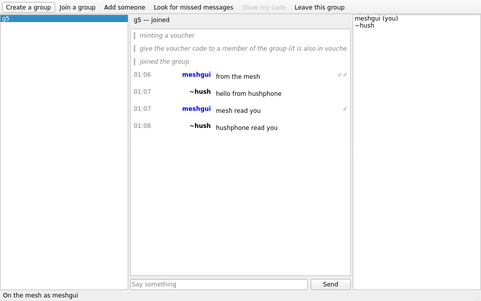

# katzenrns

Group chat over a Reticulum mesh, on Pigeonhole boxes. katzenrns speaks the same katzenqt1
protocol as katzenqt does on the Katzenpost mixnet, so a group can have members on a mesh and
members on the mixnet, talking through a bridge replica without knowing it. The protocol is
[pigeonhole_protocols](https://github.com/katzenpost/pigeonhole_protocols) (its `py/`); the
mesh replicas and the mesh half of the bridge are [pigeonhole_rns](https://github.com/katzenpost/pigeonhole_rns),
the bridge socket on the mixnet replica is in the Katzenpost repository; the design is
the Pigeonhole over Reticulum specification on the Katzenpost website.

On the mesh, this client does the BACAP encryption itself with hpqc and sends sealed boxes to
the nearest replica it hears announce. There is no daemon between the client and the mesh. In
open mode, BACAP is the only protection; a closed mesh adds a Noise layer in the transport.

  

Alice Cryptwalker on a Reticulum mesh, in one group with Bobby Lobby on
[hushphone](https://github.com/katzenpost/hushphone) over the namenlos mixnet. Alice joined by
voucher through a bridge replica; the greetings crossed it both ways, and the check marks on
Alice's lines mean written to the mesh replica (one) and read by Bobby (two).

## Run

    pip install katzenrns

katzenrns needs a Reticulum instance with a path to a Pigeonhole replica. There are two ways to
have one, and the choice is only about Reticulum; the chat is the same in both.

### With your own rnsd

If you run Reticulum already, katzenrns attaches to it like any other Reticulum program: the
instance `~/.reticulum` describes, which is your running `rnsd`, or one katzenrns starts from
that config when none is running. The replica has to be reachable from that instance. For the
bridge replica on windfall2, which joins the mesh to the
[namenlos](https://katzenpost.network) mixnet, that is one TCP client interface in
`~/.reticulum/config`, after which rnsd is restarted:

    [interfaces]
      [[namenlos bridge replica]]
        type = TCPClientInterface
        enabled = yes
        target_host = 162.220.11.225
        target_port = 4242

Then:

    katzenrns                           # the desktop client
    katzenrns --headless --name bob     # commands on stdin, for scripts

A Reticulum instance that already reaches the replica some other way, through a transport node
that peers with it, needs no edit at all. `--config DIR` points katzenrns at a Reticulum config
directory other than `~/.reticulum`.

### Without Reticulum of your own

If you have never run Reticulum and only want to reach a replica on the internet, give its
address and nothing else:

    katzenrns --replica 162.220.11.225:4242
    katzenrns --replica 162.220.11.225:4242 --headless --name bob

katzenrns then starts a Reticulum instance of its own, with one TCP link to that replica, from a
config it writes under its state directory (`~/.local/share/katzenrns/reticulum/config`). That
instance is private to katzenrns: it does not touch `~/.reticulum`, and it is not shared with
other Reticulum programs, so a running rnsd and this instance coexist without seeing each other.
`--replica` and `--config` are the two ways to reach the mesh; give one.

### In both cases

The status bar reads "On the mesh" within about twenty seconds, once the replica has announced.
The box size defaults to namenlos's, 1549 bytes; a mesh of its own with another size sets
`--box-size`.

`--wire-version 3|4` picks the katzenqt1 wire version this client writes and mints: 3 is the
version 3 map form with long vouchers, for peers that read only that; 4, the default, is the
compact form. Either version reads both.

The first launch of the desktop client asks for the name you show others. Then: **Create a
group**, or **Join a group**, which shows a voucher code to send to someone already in the
group; they paste it into **Add someone**. The code is the same text katzenqt uses, so a
katzenqt user can add you, and you them.

The headless shell takes `create g`, `join g`, `invite g CODE`, `send g text`, `show g`,
`members g`, `scan g`, `remove g NAME`, `leave g` and prints `READY`, `VOUCHER=...`,
`JOINED g` and `LINE g who: text` as things happen.

## Releases

Each release on the [releases page](https://github.com/katzenpost/katzenrns/releases) has a
single-file Linux executable, `katzenrns-VERSION-linux-x86_64`, with Python, Reticulum, Qt and
the rest inside, built on Ubuntu 22.04 to run on distributions with glibc 2.35 or newer; and the
wheel and source archive. To verify and run one, with the files and `SHA256SUMS` in one directory:

    sha256sum --check --ignore-missing SHA256SUMS
    chmod +x katzenrns-VERSION-linux-x86_64
    ./katzenrns-VERSION-linux-x86_64 --replica 162.220.11.225:4242

It takes the same options as `katzenrns` below. The desktop client uses the OpenGL and X11
libraries a desktop already has; the headless shell needs none.

To cut a release, set the version in `pyproject.toml` and push the matching tag,
`git tag vX.Y.Z && git push origin vX.Y.Z`; the release workflow builds, smoke tests and
publishes it. Running that workflow by hand builds the same files as workflow artifacts and
publishes nothing.

## Test

    pip install -e .[test]
    pytest
    python tests/e2e_mesh.py --run-dir /some/scratch/dir      # two replicas, two shells

With a docker mixnet up in a Katzenpost checkout (`make -C docker start wait`) and the mesh replica container up
(`pigeonhole_rns/tests/docker_bridge.sh start katzenpost/docker/mixnet-alpine`),
two scripts put a katzenrns shell on the mesh in one group with a mixnet client, through the
bridge, each founding once and joining once, and check that each reads and acknowledges the
other:

    scripts/interop.sh host ../katzenpost            # with pigeonhole_protocols' Go katzenqt1
    scripts/interop.sh guest ../katzenpost
    KATZENQT=../katzenqt/.venv/bin/katzenqt-headless scripts/interop-katzenqt.sh host ../katzenpost
    KATZENQT=../katzenqt/.venv/bin/katzenqt-headless scripts/interop-katzenqt.sh guest ../katzenpost

The interop workflow runs all four on every push.
